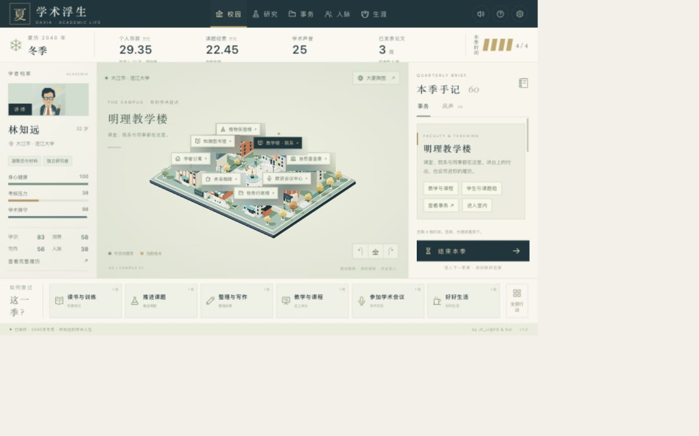

# DAL · Daxia Academic Life

**by JF_Li@FD & Sol**

[中文说明](README.md) · **[Download the v1.0.0 player package](https://github.com/JianfengFD/DAL/releases/download/v1.0.0/DAL-v1.0.0-portable.zip)** · [Latest releases](https://github.com/JianfengFD/DAL/releases/latest) · [Gameplay guide, in Chinese](docs/GAMEPLAY.md)

A single-player, quarterly strategy RPG about building a career in the fictional academic world of **Daxia**. Balance research, teaching, funding, colleagues, university administration, reputation, and everyday life. The game interface and narrative are in Chinese.

[](docs/media/dal-gameplay-zh.mp4)

**[Watch the Chinese gameplay video](docs/media/dal-gameplay-zh.mp4)** · **[Download the MP4](https://github.com/JianfengFD/DAL/releases/download/v1.0.0/DAL-gameplay-zh.mp4)**

The approximately four-minute narrated demonstration follows a young lecturer from **age 32**, through promotion to associate professor at **36 years and 9 months**, to a Distinguished Young Scholar award at **40**. Play can continue beyond that milestone.

## Download and play

Download **[DAL-v1.0.0-portable.zip](https://github.com/JianfengFD/DAL/releases/download/v1.0.0/DAL-v1.0.0-portable.zip)** and extract the whole folder. Newer versions will appear under [Releases](https://github.com/JianfengFD/DAL/releases/latest). You need **Python 3.9+** and a modern desktop browser with WebGL support. Node.js and Blender are not required for the portable game.

**The release player package includes `dist/`. GitHub's green `Code → Download ZIP` provides source code, which requires `npm ci` and `npm run build` before using the launcher.**

| Platform | Start |
| --- | --- |
| macOS | Double-click `macOS.command` |
| Windows | Double-click `Windows.bat` |
| Linux | Run `bash ./Linux.sh` in the extracted directory |

Launchers are provided for all three platforms. macOS and the Python loopback HTTP server have been tested locally; the Windows and Linux launchers have not been tested on those operating systems.

Alternatively, run `python3 run_game.py` from that directory; on Windows, `py -3 run_game.py` also works. Keep the terminal open while playing, and press `Ctrl+C` there to stop the server.

The launcher serves the bundled build on `127.0.0.1` and opens your browser. Use the address printed in the terminal; if the default port is occupied, another available port is selected. Open the game through the launcher rather than opening `dist/index.html` directly.

## What is included

- Three starting points: undergraduate at 18, doctoral student at 25, and young lecturer at 32; five research fields, five backgrounds, and three difficulty settings.
- Research projects, writing, journal review, grant applications, teaching, student supervision, colleagues, and campus administration.
- Separate career and talent-award tracks, including professor, young-scholar awards, and academician honors.
- Six cities, four departments, six university offices, twelve main characters, six named conferences, and 67 narrative events with 201 choices.
- Original Blender campus, laboratory, conference hall, and classroom scenes, with browser-based 3D interaction and optional synthesized ambient audio.

Each quarter offers four time slots. Choices can create delayed consequences, including research-integrity and financial-audit risks. Several career outcomes reward teaching, research, or a sustainable life.

## Saves

Progress is automatically saved in the current browser. Use the settings button to export or import a JSON save. Export before changing browsers, devices, or local ports: browser storage belongs to the specific origin. Importing a save or starting a new game replaces the current autosave. No account or cloud save service is required.

## Develop from source

Requires Node.js **20.19+ or 22.12+** and npm. The repository root is the game directory:

```bash
git clone https://github.com/JianfengFD/DAL.git
cd DAL
npm ci
npm run dev
```

```bash
npm test
npm run build
python3 run_game.py
```

The build is written to `dist/`. Blender is needed only to regenerate the scene assets; see [scene documentation](blender/README.md). Further technical notes: [architecture](docs/ARCHITECTURE.md) and [validation](docs/VALIDATION.md).

## Fiction and rights

All institutions, cities, universities, characters, events, salaries, grants, age limits, and review rules are fictional game design. They do not describe identifiable people or promise real-world compensation. [Official reference sources](docs/SOURCES.md) explain the distinctions between academic positions, research funding, honors, and personal income.

Free download and play are welcome. Copyright in the original code, narrative, scenes, and other original assets is reserved; no additional permission for redistribution or commercial use is granted. Third-party licenses are listed in [public/THIRD_PARTY_NOTICES.txt](public/THIRD_PARTY_NOTICES.txt).
