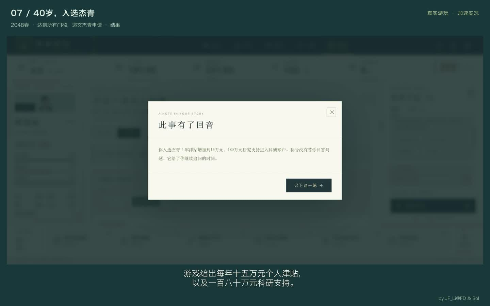

# 实际游玩解说视频

by JF_Li@FD & Sol

[观看或下载：青年教师到杰青（中文解说）](dal-gameplay-zh.mp4)

- 时长：4分12秒；1440×900，30 fps；H.264 + AAC。
- 本地正常难度，32岁讲师开局，36岁9个月晋升副教授，40岁入选杰青。
- 使用真实游戏操作画面做加速剪辑，配中文合成旁白与字幕。
- 总论文8篇，其中本轮新增5篇；主持项目4项，包含开局已有的启动经费。
- 评审条件与待遇数值均为游戏设定。

## 章节

00:00 青年讲师开局与教学
00:34 原创课题、院系与人情
01:12 青年基金与第二篇代表作
01:47 正式晋升副教授
02:24 副教授之后的教学与科研
02:57 最后一篇与最后几道选择
03:31 40岁，入选杰青
